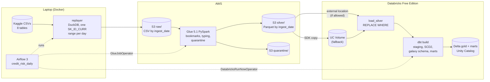

# Credit Risk Lakehouse

A credit risk lakehouse on the Kaggle [Home Credit Default Risk](https://www.kaggle.com/competitions/home-credit-default-risk) dataset: S3 landing, AWS Glue (PySpark) for bronze to silver, Databricks Free Edition with dbt for silver to gold, and Airflow to run it day by day.

**What this is:** a learning project built to practice Spark, incremental loading and dimensional modeling on Databricks. The data is a public dataset, the daily arrivals are simulated by a replayer script, and it is not production software. Where something has not been run end to end yet, this README says so.

## At a glance

- **Galaxy schema:** 7 incremental fact tables, each merged on its grain key, sharing 4 dimensions (`dim_client` and `dim_contract_type` are conformed): `fact_loan_application`, `fact_bureau_credit`, `fact_bureau_balance_monthly`, `fact_previous_application`, `fact_installment_payment`, `fact_pos_cash_monthly`, `fact_credit_card_monthly`. See [dbt: staging, SCD2, galaxy schema](docs/design-decisions.md#dbt-staging-scd2-galaxy-schema).
- **SCD Type 2:** `snap_client`, a dbt snapshot (check strategy on 8 client attributes). After 3 replayed days it holds 6,050 rows, 50 of them closed versions.
- **Tests:** 93 dbt data tests (90 generic, 3 singular), all passing in the Databricks job run of 2026-10-20 (`PASS=119`, which is 93 tests, 25 models and 1 snapshot). Python tests cover the replayer, the Glue transforms on Spark and the Airflow helpers, and CI runs ruff, pytest and `dbt parse` on every push. See [docs/testing.md](docs/testing.md).
- **Not run yet:** managed Glue (blocked by the AWS Free account plan) and the Airflow DAG against real services. See [Known limitations](#known-limitations).

## Architecture



| Layer | Tool | Responsibility |
|---|---|---|
| Landing | S3 + `replayer/` | One slice of every source table per simulated day, under `raw/<table>/ingest_date=YYYY-MM-DD/` |
| Bronze to silver | AWS Glue (`glue/`) | Schema checks, type casting, snake_case names, known data fixes, bad rows to `quarantine/`, partitioned Parquet in `silver/` |
| Silver to gold | Databricks + dbt (`dbt/`) | Load silver into Delta, staging, SCD2 snapshot, galaxy schema, credit risk marts, tests |
| Orchestration | Airflow 3 (`airflow/`) | One DAG run per `ingest_date`; backfills by date range |

**The split that matters:** Glue owns ingestion and cleaning; Databricks owns modeling. Neither redoes the other's Spark work. Glue never builds a dimension, and dbt never re-casts a column.

## Repository map

Folders are listed in the order data flows through them.

```
.
├── README.md                    ← you are here: the big picture
├── docs/                        ← design decisions, how to run it, test results (index: docs/README.md)
│
│  ── 1 · Landing ───────────────────────────────────────────────────────
├── replayer/                    # simulated daily arrivals: cuts one SK_ID_CURR range per day (DuckDB)
│   └── tests/
│
│  ── 2 · Bronze → silver (AWS Glue) ────────────────────────────────────
├── glue/                        # see glue/README.md
│   ├── jobs/bronze_to_silver.py #   Glue entrypoint: reads, bookmarks, writes
│   ├── silver_lib/              #   pure PySpark: table specs, typing, cleaning, quarantine
│   ├── iam/                     #   trust + permissions policy for the job role
│   └── tests/                   #   unit tests + container smoke test
├── scripts/
│   ├── deploy_glue_job.py       # uploads the code and creates the Glue job
│   └── push_local_silver.py     # uploads local silver to the Databricks Volume (testing without AWS)
│
│  ── 3 · Silver → gold (Databricks + dbt) ──────────────────────────────
├── databricks/s3_access_test/   # runbook: can Free Edition read S3 directly? (it can)
├── dbt/                         # see dbt/README.md
│   ├── macros/                  #   load_silver, hashed keys, schema naming
│   ├── models/staging/          #   newest version of each record
│   ├── snapshots/               #   snap_client — SCD Type 2
│   ├── models/gold/             #   4 dims + 7 incremental facts (galaxy schema)
│   ├── models/intermediate/     #   per-client summaries
│   ├── models/marts/            #   delinquency, default rate, applicant features
│   ├── models/dq/               #   orphan report
│   ├── tests/                   #   singular + generic tests
│   ├── databricks.yml           #   Databricks Asset Bundle
│   └── resources/               #   the dbt job definition
│
│  ── 4 · Orchestration (Airflow 3) ─────────────────────────────────────
├── airflow/
│   ├── docker-compose.yml, Dockerfile
│   ├── dags/credit_risk_daily.py    # one run per ingest_date
│   ├── dags/credit_risk_lib/        # run plan + Volume sync helpers
│   └── tests/
│
│  ── Shared ────────────────────────────────────────────────────────────
├── tests/fixtures/home_credit/  # tiny synthetic Home Credit CSVs used by every test
├── .env.example                 # every setting the pipeline reads
├── pyproject.toml, requirements-dev.txt
└── .github/workflows/ci.yml     # ruff, pytest and dbt parse on every push
```

## Data

Eight source files, about 2.5 GB of CSV. The large ones are why this uses Spark:

| Table | Rows (approx.) | Key | Silver merge key |
|---|---|---|---|
| application_train / application_test | 307k / 49k | SK_ID_CURR | sk_id_curr |
| bureau | 1.7M | SK_ID_BUREAU | sk_id_bureau |
| bureau_balance | 27M | SK_ID_BUREAU + MONTHS_BALANCE | same |
| previous_application | 1.7M | SK_ID_PREV | sk_id_prev |
| POS_CASH_balance | 10M | SK_ID_PREV + MONTHS_BALANCE | same |
| credit_card_balance | 3.8M | SK_ID_PREV + MONTHS_BALANCE | same |
| installments_payments | 13.6M | none | record_hash |

There are no calendar dates in this data. Every time column is relative (`DAYS_BIRTH`, `DAYS_DECISION`, `MONTHS_BALANCE`). So nothing is partitioned by business date; every layer is partitioned by `ingest_date`, the day the replayer delivered the slice.

## Quick start

Try the replayer on the bundled fixtures, with no cloud account at all:

```bash
pip install -r requirements-dev.txt
python -m replayer.replay --data-dir tests/fixtures/home_credit --ingest-date 2026-10-01 \
    --clients-per-slice 3 --target local --out-dir out/landing
pytest -q          # replayer, Glue transforms (needs Java 17) and Airflow helpers
```

The full setup (AWS, Databricks, Airflow) and the shortcuts for running pieces without AWS are in
[docs/running.md](docs/running.md).

## Known limitations

- Arrivals are simulated, and the SCD2 changes come from the replayer's `--resend-updates`, not from the data.
- dbt has run against Databricks only from a laptop, on 3 replayed days through the Volume. The Glue job has run only in the local Glue 5 container against S3, with bookmarks off, because managed Glue is blocked by the AWS Free account plan (`CreateJob` is denied until the plan is upgraded). Job bookmarks and the Airflow DAG have not run against real services yet.
- Free Edition can run the job's serverless dbt task (installing dbt-databricks with pip worked). It has been run once, by hand, for one day; the Airflow trigger has not run.
- An orphan fact keeps the unknown client even if the parent application arrives in a later delivery. Range slicing makes this rare, but nothing re-points those rows.
- The local Glue image ships Spark 3.5.2 while Glue 5.1 runs Spark 3.5.6; the tests do not depend on the difference.
- Glue infrastructure is created by a boto3 script, not Terraform (stretch goal).
- Unity Catalog column masks and row filters for PDPA-sensitive fields (income, age, family status) are a stretch goal and not built yet.

## Documentation

| I want to… | Read |
|---|---|
| Understand why each layer works the way it does, and the decision log | [docs/design-decisions.md](docs/design-decisions.md) |
| Set it up, run it, or run parts of it without AWS; what it costs | [docs/running.md](docs/running.md) |
| See what is tested and what has actually run against real services | [docs/testing.md](docs/testing.md) |
| Work on the Glue job | [glue/README.md](glue/README.md) |
| Work on the dbt project | [dbt/README.md](dbt/README.md) |
| Check whether Databricks Free Edition can read S3 | [databricks/s3_access_test/README.md](databricks/s3_access_test/README.md) |
