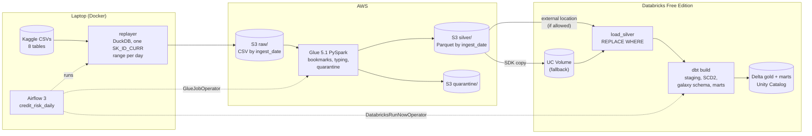

# Credit Risk Lakehouse

A credit risk lakehouse on the Kaggle [Home Credit Default Risk](https://www.kaggle.com/competitions/home-credit-default-risk) dataset: S3 landing, AWS Glue (PySpark) for bronze to silver, Databricks Free Edition with dbt for silver to gold, and Airflow to run it day by day.

**What this is:** a learning project built to practice Spark, incremental loading and dimensional modeling on Databricks. The data is a public dataset, the daily arrivals are simulated by a replayer script, and it is not production software. Where something has not been run end to end yet, this README says so.

## Architecture



| Layer | Tool | Responsibility |
|---|---|---|
| Landing | S3 + `replayer/` | One slice of every source table per simulated day, under `raw/<table>/ingest_date=YYYY-MM-DD/` |
| Bronze to silver | AWS Glue (`glue/`) | Schema checks, type casting, snake_case names, known data fixes, bad rows to `quarantine/`, partitioned Parquet in `silver/` |
| Silver to gold | Databricks + dbt (`dbt/`) | Load silver into Delta, staging, SCD2 snapshot, galaxy schema, credit risk marts, tests |
| Orchestration | Airflow 3 (`airflow/`) | One DAG run per `ingest_date`; backfills by date range |

**The split that matters:** Glue owns ingestion and cleaning; Databricks owns modeling. Neither redoes the other's Spark work. Glue never builds a dimension, and dbt never re-casts a column.

## Repository layout

```
replayer/                 simulated daily arrivals (DuckDB), tests
glue/                     Glue job: silver_lib (pure PySpark), entrypoint, IAM, tests
scripts/deploy_glue_job.py
databricks/s3_access_test/  runbook for the Free Edition S3 question
dbt/                      dbt project + Databricks Asset Bundle (the dbt job)
airflow/                  Airflow 3 compose, DAG, helpers, tests
tests/fixtures/           tiny synthetic Home Credit CSVs used by every test
```

## Data

Eight source files, about 2.5 GB of CSV. The large ones are why this uses Spark:

| Table | Rows (approx.) | Key | Silver merge key |
|---|---|---|---|
| application_train / application_test | 307k / 49k | SK_ID_CURR | sk_id_curr |
| bureau | 1.7M | SK_ID_BUREAU | sk_id_bureau |
| bureau_balance | 27M | SK_ID_BUREAU + MONTHS_BALANCE | same |
| previous_application | 1.7M | SK_ID_PREV | sk_id_prev |
| POS_CASH_balance | 10M | SK_ID_PREV + MONTHS_BALANCE | same |
| credit_card_balance | 3.8M | SK_ID_PREV + MONTHS_BALANCE | same |
| installments_payments | 13.6M | none | record_hash |

There are no calendar dates in this data. Every time column is relative (`DAYS_BIRTH`, `DAYS_DECISION`, `MONTHS_BALANCE`). So nothing is partitioned by business date; every layer is partitioned by `ingest_date`, the day the replayer delivered the slice.

## Design decisions

### Replayer: one client range per day

`replayer/` cuts slice *k* as a contiguous `SK_ID_CURR` range (default 2,000 applications), with `ingest_date = start_date + k days`. Every child table is cut with the same range, so a client's bureau, previous application and payment rows arrive on the same day as the application.

A range is used instead of an exact client list on purpose: child rows whose client has no application (orphans) still fall inside some range and reach the pipeline, where dbt counts them. An exact-list filter would have dropped them silently. `bureau_balance` rows with no parent bureau credit are spread across days by `SK_ID_BUREAU` modulo the number of slices.

The source data never changes a client, so there is nothing for an SCD2 snapshot to record. `--resend-updates N` re-sends N earlier clients with a 10% higher income and a different family status. These changes are synthetic and exist only to exercise the snapshot.

### Glue: bookmarks plus dynamic partition overwrite

- **Job bookmarks** (one `transformation_ctx` per table) make a normal run process only the files that arrived since the last successful run. `job.commit()` is the last line, so a failed run does not advance the bookmark.
- **Dynamic partition overwrite** replaces only the `ingest_date` partitions present in the batch. Writing the same day twice gives the same result.
- **Reprocessing a day** (`--reprocess_ingest_date D` with bookmarks disabled) reads only `raw/<table>/ingest_date=D/`, so it rebuilds exactly that day. A table with no files that day comes back as an empty frame and is skipped (the smoke test covers this).
- **Quarantine instead of drop:** rows with a missing key, an unparseable value or no `ingest_date` go to `quarantine/<table>/` with the reasons and the original strings. If more than 5% of a table's rows are bad, the job fails before writing silver (`--max_quarantine_ratio`).
- **Rule-based typing** (`glue/silver_lib/specs.py`) instead of a 300-column hand-written schema: `SK_ID_*` bigint, `DAYS_*` and 0/1 flags int, `AMT_*` and `CNT_*` double, and so on. Unknown columns fall back to string and are logged, so a new column never causes a quarantine. Integers parse through double, so `"2.0"` is fine and `"2.5"` is a bad cast. `try_cast` keeps this safe under ANSI mode too.
- The transformations live in `silver_lib`, plain PySpark with no `awsglue` imports, so they are unit tested in a local SparkSession.

### Getting silver into Databricks

Open question from the start: can a Unity Catalog external location on Free Edition read my own S3 bucket? `databricks/s3_access_test/` is the runbook to find out. The pipeline supports both answers through one setting, `SILVER_ACCESS_MODE`:

- `external_location`: dbt reads `s3://<bucket>/silver/` directly.
- `volume`: Airflow copies the day's silver Parquet into the Volume `<catalog>.landing.silver` with the Databricks SDK, clearing that day's folder first.

Either way, the dbt macro `load_silver` runs `INSERT INTO silver.<table> REPLACE WHERE ingest_date = <day> SELECT ... FROM read_files(...)`. This atomically swaps one day's rows in a Delta table, mirroring Glue's partition overwrite on the Databricks side. It adds `_loaded_at` and changes nothing else.

### dbt: staging, SCD2, galaxy schema

- **Staging** keeps the newest version of each business key, ordered by `ingest_date` then `_loaded_at`. Ordering by load time alone would let an out-of-order backfill of an old day win over newer data.
- **Hashed surrogate keys** (md5 of the business key) instead of `row_number()`. The old Glue draft used window functions for keys. Those depend on which rows happen to be in the table at build time, so the same client could get a different key after a rebuild, which breaks incremental facts. A hash is the same on every run, so dimensions can be rebuilt in full while facts load incrementally.
- **Incremental facts** read only staging rows with a `_loaded_at` newer than the newest row already loaded, then `MERGE` on the business key. Staging's dedupe guarantees one row per key per batch, which Databricks MERGE requires.
- **`snap_client`** (dbt snapshot, check strategy) records SCD Type 2 history of client attributes. `dim_client` has one row per client version, and a fact row keeps the version that was current when it was loaded.
- **Galaxy schema:** 7 facts (applications, bureau credits, bureau months, previous applications, installment payments, POS cash months, credit card months) share conformed dimensions. `dim_client` and `dim_contract_type` are shared across facts; contract type is conformed between current applications (Cash loans, Revolving loans) and previous applications (which add Consumer loans and XNA).
- **No dbt packages:** Free Edition serverless has restricted outbound internet, so `dbt deps` might not reach dbt Hub. The one helper needed (`unique_combination`) is a 10-line generic test.

### Data quality

| Issue | Where | Handling |
|---|---|---|
| `DAYS_EMPLOYED = 365243` means pensioner or unemployed, not 1,000 years of tenure | Glue | Nulled, `days_employed_is_sentinel = true`. Same for five `DAYS_*` columns in previous_application. Singular dbt test plus unit test |
| `CODE_GENDER = 'XNA'` | Glue | Nulled; dbt `accepted_values` is just M and F |
| Unparseable values, missing keys | Glue | Quarantined with reasons; 5% circuit breaker |
| Orphaned foreign keys (for example a bureau row whose client has no application) | dbt | **Kept, not dropped.** Facts point at the unknown client member (`client_sk = '-1'`) so totals still add up. `dq_orphan_report` counts orphans per relationship every run; a warn-level test fires when the latest load is more than 2 points away from the relationship's expected rate |
| Installments have no natural key | Glue + dbt | `record_hash` (SHA-256 of all business columns) is the key. Rows identical in every column collapse into one; this is a deliberate policy |
| Duplicate keys within one delivery | dbt | Warn-level `unique_combination` tests on every silver source |
| Freshness | dbt | `dbt source freshness` warns when the newest `ingest_date` is over 2 days old (warn only, because backfills load old days) |

Plus `unique`, `not_null`, `relationships` (every fact's `client_sk` to `dim_client`, and the other dimension keys) and `accepted_values` tests: 93 data tests in total.

**Orphan rates in the real data.** Two relationships are orphaned in the source itself:

| Relationship | Full dataset (DuckDB over the CSVs) | First 3 replayed days (`dq_orphan_report`) |
|---|---|---|
| bureau_balance to bureau (`sk_id_bureau`) | 3,120,184 of 27.3M rows (11.4%) | 51,529 of 464,126 (11.1%) |
| installments_payments to previous_application (`sk_id_prev`) | 1,250,826 of 13.6M rows (9.2%) | 21,076 of 224,373 (9.4%) |

The other five relationships (every child table to its application) had no orphans in the replayed days. For bureau_balance the replayed rate matching the full dataset also shows that the `SK_ID_BUREAU` modulo rule spreads parentless rows evenly across days instead of piling them into one. Installments are sliced by client range like every other table, so their orphans simply arrive with their client.

The first version of the check warned on any relationship above a flat 1%, so it fired on every run and stopped meaning anything. Now each relationship has an expected rate (the full dataset figure, 0% for the other five), and `assert_orphan_rate_near_baseline` warns only when the latest load (the rows with the newest `_loaded_at`, which also covers a backfilled day) is more than `orphan_warn_margin_pct` (2) points away from it. On days 1 and 3 the daily rates were within 1 point of the expected rates.

### Orchestration

`credit_risk_daily` runs one `ingest_date` per DAG run: plan the run, land the raw slice, run the Glue job, optionally sync to the Volume, then trigger the Databricks job. `max_active_runs=1` because bookmarks and watermarks expect days in order. Backfill a range with:

```bash
airflow backfill create --dag-id credit_risk_daily --from-date 2026-10-01 --to-date 2026-10-07 --max-active-runs 1
```

Trigger with `reprocess=true` to rebuild one day, or `land_slice=false` when the raw files are already in S3.

## Decision log

| Date | Decision | Why |
|---|---|---|
| 2026-10-15 | No Snowflake | Not used by any target employer, and the trial expired |
| 2026-10-15 | Glue stops at silver; modeling moved to dbt | One owner per responsibility; no duplicated Spark work |
| 2026-10-15 | Glue 5.1 (Spark 3.5.6) | AWS default version at the time; Glue 6.0 was too new |
| 2026-10-15 | Airflow 3 | Scheduler-managed backfills; the ecommerce repo already shows Airflow 2 |
| 2026-10-19 | Lake bucket in `us-east-2` | `SELECT current_metastore()` shows the Free Edition workspace runs in AWS `us-east-2`. Keeping S3 in the same region avoids cross-region transfer, whichever way silver reaches Databricks |
| 2026-10-19 | Test dbt on Databricks before any AWS run | The Volume path needs no AWS: a local `spark-submit` of the Glue job writes silver, `scripts/push_local_silver.py` uploads it with the same code the DAG uses, and dbt runs against the SQL warehouse. This tested the riskiest untested parts first |
| 2026-10-20 | `SILVER_ACCESS_MODE=external_location` | The Free Edition S3 test passed: a storage credential and external location on `s3://<bucket>/silver/` were created through the SDK, and `LIST` and `read_files` returned the probe rows. The Volume copy stays as the fallback |
| 2026-10-20 | Run the Glue job in the local Glue 5 container against S3 | Managed Glue is blocked: the account is on the AWS Free account plan and `CreateJob` returns "Account ... is denied access". The same entrypoint runs with `spark-submit` in `public.ecr.aws/glue/aws-glue-libs:5` with `s3://` roots until the plan is upgraded. The Glue role and the job code are already deployed for that day |

## Running it

Prerequisites: Python 3.11+, Docker, an AWS account with the CLI configured, a Databricks Free Edition workspace, and the Kaggle CSVs in `data/raw/` (`kaggle competitions download -c home-credit-default-risk`).

1. `cp .env.example .env` and fill it in.
2. Create the bucket, then the Glue role from `glue/iam/` (trust policy plus the permissions policy with your bucket name).
3. `python scripts/deploy_glue_job.py` uploads the code and creates the Glue job.
4. Run the S3 test in `databricks/s3_access_test/` and set `SILVER_ACCESS_MODE`.
5. From `dbt/`: `databricks bundle deploy --var silver_root=s3://<bucket>/silver` (in `external_location` mode; the default is the Volume path; add `--var catalog=workspace` if needed). Any recent Databricks CLI works; it can be unzipped anywhere and called by full path.
6. From `airflow/`: `docker compose --env-file ../.env up -d --build`, open http://localhost:8080, and unpause `credit_risk_daily`, or trigger it with an `ingest_date`.

To run the Glue job against S3 without managed Glue, land a day with `python -m replayer.replay --target s3 --bucket <bucket>`, then run the same `spark-submit` as the smoke test in the Glue 5 container with `--raw_root`, `--silver_root` and `--quarantine_root` set to `s3://<bucket>/...`, `--job-bookmark-option job-bookmark-disable` and `--reprocess_ingest_date <day>`. Pass `AWS_ACCESS_KEY_ID`, `AWS_SECRET_ACCESS_KEY`, `AWS_SESSION_TOKEN` and `AWS_REGION` to `docker run` with `-e NAME` (the container cannot use an `aws login` profile). The `s3://` scheme worked in the image as it is.

Try the replayer locally without any cloud:

```bash
pip install -r requirements-dev.txt
python -m replayer.replay --data-dir tests/fixtures/home_credit --ingest-date 2026-10-01 \
    --clients-per-slice 3 --target local --out-dir out/landing
```

Run the real data through Glue and dbt on Databricks without AWS (the Volume path). This needs the Kaggle CSVs in `data/raw/`, the `DATABRICKS_*` values in `.env` exported to the shell, and `dbt/profiles.yml` copied from the example:

```bash
# 1. Land one day and run the Glue job locally (same docker run as glue/tests/smoke/run_smoke.sh,
#    with --raw_root, --silver_root and --quarantine_root under out/real/)
python -m replayer.replay --ingest-date 2026-10-01 --cache-dir data/cache --out-dir out/real/landing

# 2. Upload that day's silver into the Volume /Volumes/<catalog>/landing/silver
python scripts/push_local_silver.py --silver-dir out/real/silver --ingest-date 2026-10-01

# 3. Load it into Delta and build, as the Databricks job does (from dbt/)
dbt run-operation load_silver --args '{"ingest_date": "2026-10-01"}'
dbt source freshness
dbt build
```

## Testing

| What | How | Status |
|---|---|---|
| Replayer | `pytest replayer/tests` | 14 tests pass |
| Glue transforms (Spark) | pytest in the `public.ecr.aws/glue/aws-glue-libs:5` container, see `glue/README.md` | 49 tests pass |
| Glue entrypoint | `glue/tests/smoke/run_smoke.sh`: real `spark-submit` on replayer output, then a reprocess run of a day with empty tables | passes |
| Airflow run plan and Volume sync | `pytest airflow/tests` (fakes for S3 and the Files API) | pass |
| DAG integrity | pytest inside the Airflow image; `plan_run` also run with `airflow tasks test` | pass |
| dbt | `dbt parse` (no connection) | passes: 25 models, 1 snapshot, 8 sources, 93 tests |
| Glue job on the real data | Local `spark-submit` in the Glue 5 container on 3 replayed days (about 980k rows), default 5% quarantine limit | passes in 1 min 40 s: 0 rows quarantined in all 8 tables, no column fell back to string, `DAYS_EMPLOYED` sentinel on about 18% of applicants |
| dbt against Databricks | Local dbt against the Free Edition SQL warehouse, 3 days through the Volume path, one `load_silver` plus `dbt build` per day | passes every day: 118 PASS, 1 WARN (the old flat 1% orphan check; its replacement passes on day 3 and warns as intended when the margin is tightened to 0.5), 0 errors, 2.5 to 3 min per build. After day 3: 6,000 clients in `fact_loan_application`, the 50 re-sent clients updated in place by MERGE, 50 closed versions in `snap_client`, every other fact equal to its silver row total |
| Glue job against S3 (local container) | `spark-submit` of `bronze_to_silver.py` in the Glue 5 container with `s3://` raw, silver and quarantine roots, one `--reprocess_ingest_date` run per day (bookmarks off), days landed by `replayer --target s3` | passes for 3 days: 5 min 20 s to 6 min 30 s per run, about 980k rows, 0 rows quarantined, silver row counts equal to the earlier local run for all 8 tables and 3 days |
| External location on real silver | `read_files('s3://<bucket>/silver/<table>/', format => 'parquet')` through the SQL warehouse | reads all 8 tables, `ingest_date` comes back as a partition column, counts match the local silver |
| Databricks job (bundle) | `databricks bundle validate`, `deploy --var silver_root=s3://<bucket>/silver`, then `bundle run credit_risk_dbt --params ingest_date=2026-10-03` (serverless dbt task, silver read from S3 through the external location) | passes: 2 min 47 s, PASS=119 WARN=0 ERROR=0 SKIP=0 (93 tests, 25 models, 1 snapshot). The 8 source freshness checks warn, as they do locally, because the data is older than the freshness window. The day was already loaded, so it doubles as an idempotency test: every fact, dim and mart count, `snap_client` rows (6,050, 50 closed) and `dq_orphan_report` rows were identical before and after |
| Cloud end to end | Managed Glue on AWS, the Airflow DAG against real services | **not run**: managed Glue is blocked by the AWS Free account plan, and the DAG has not run |

## Cost notes

Estimates use us-east-1 list prices at the time of writing; check your region.

- **Glue:** 2 G.1X workers = 2 DPU. With the Flex execution class ($0.29 per DPU-hour, against $0.44 standard) and a run of about 3 minutes on a 2,000-client slice: 2 × 0.05 h × $0.29, roughly **$0.03 per run**. Glue bills a 1-minute minimum per run.
- **S3:** the full dataset is about 2.5 GB raw plus less in Parquet: a few cents per month. Requests are negligible at one slice per day.
- **Data transfer:** the Volume fallback downloads each day's silver Parquet out of AWS (a few MB per slice), well inside AWS's monthly free data transfer allowance.
- **Databricks Free Edition:** $0, under a fair usage quota. Going over it shuts compute down for the day, which is why slices default to 2,000 clients.
- **Airflow:** local Docker, $0.

A daily run therefore costs a few cents, almost all of it Glue.

## Known limitations

- Arrivals are simulated, and the SCD2 changes come from the replayer's `--resend-updates`, not from the data.
- dbt has run against Databricks only from a laptop, on 3 replayed days through the Volume. The Glue job has run only in the local Glue 5 container against S3, with bookmarks off, because managed Glue is blocked by the AWS Free account plan (`CreateJob` is denied until the plan is upgraded). Job bookmarks and the Airflow DAG have not run against real services yet.
- Free Edition can run the job's serverless dbt task (installing dbt-databricks with pip worked). It has been run once, by hand, for one day; the Airflow trigger has not run.
- An orphan fact keeps the unknown client even if the parent application arrives in a later delivery. Range slicing makes this rare, but nothing re-points those rows.
- The local Glue image ships Spark 3.5.2 while Glue 5.1 runs Spark 3.5.6; the tests do not depend on the difference.
- Glue infrastructure is created by a boto3 script, not Terraform (stretch goal).
- Unity Catalog column masks and row filters for PDPA-sensitive fields (income, age, family status) are a stretch goal and not built yet.
